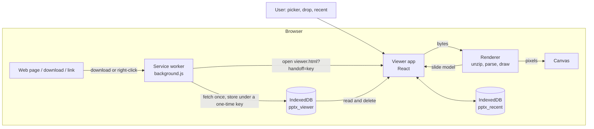
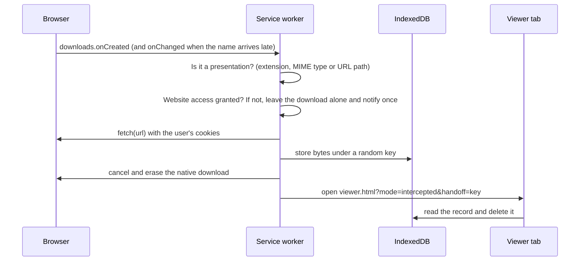
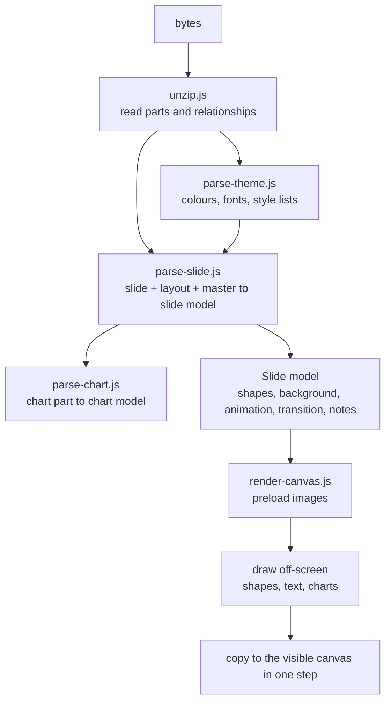

# Opendeck

[](https://github.com/go3-14/pptx_viewer_extension/actions/workflows/ci.yml)

A Chrome, Edge, Firefox and Zen extension that opens PowerPoint presentations in the browser, with search, printing and a full-screen slideshow that plays animations. It works on your device: files are parsed and drawn locally, with no server, no upload and no tracking.

- Opens `.pptx`, `.ppsx`, `.potx` and the macro-enabled variants (`.pptm`, `.ppsm`, `.potm`).
- Opens from the toolbar, by drag and drop, from a download, from a right-click on a link, or from the recent-files list.
- A purpose-built renderer for the Office Open XML format (text, shapes, tables, charts, SmartArt, pictures), written in plain JavaScript on top of the browser's Canvas API.

See [PRIVACY.md](PRIVACY.md) for exactly what is processed, stored and requested.

**Website:** <https://opendeck.gopi.is-a.dev/>. **Problems or ideas:** [open an issue](https://github.com/go3-14/pptx_viewer_extension/issues/new/choose).

## Contents

1. [Features](#features)
2. [Install](#install)
3. [Using it](#using-it)
4. [Architecture](#architecture)
5. [How a presentation is rendered](#how-a-presentation-is-rendered)
6. [Project structure](#project-structure)
7. [Supported content and limitations](#supported-content-and-limitations)
8. [Permissions and privacy](#permissions-and-privacy)
9. [Development](#development)
10. [Testing](#testing)
11. [License](#license)

## Features

**Opening files**

- Toolbar icon, file picker, or drop a file anywhere on the page.
- Downloads of presentation files open in the viewer instead of being saved. The native download is only cancelled after the file was read successfully, so a failure never loses the file.
- Right-click a presentation link and choose **Open in Opendeck**.
- Recent files (the last five) on the start screen and in the **More** menu.
- `.ppsx` shows open straight into the slideshow.

**Viewing**

- The slide fits the window by default; zoom in and out, or press `0` to fit again.
- Slide list with lazily rendered thumbnails.
- **Dark mode:** an Auto / Light / Dark toggle in the header (saved in the browser). In dark mode slide colours are inverted with their hue kept (a white slide turns near-black, black text turns near-white) while pictures are left alone; the *Invert slides in dark mode* switch in the More menu and Settings turns that off. Printing, copying and PNG export are never inverted.
- **Mouse wheel:** scroll to change slides (one slide per flick). When the slide is zoomed in beyond the window, the wheel scrolls it and changes slides at its edge. `Ctrl` + wheel zooms. The same works in the slideshow.
- Search slide text, table cells and speaker notes (`Ctrl+F`). Matching slides are marked in the slide list.
- Copy the current slide as an image or as text, copy a text outline of the whole deck (with notes), print or save as PDF, or export every slide as a ZIP of PNGs.

**Slideshow**

- Full screen, with animation builds (entrance and exit effects, one click at a time) and slide transitions (fade, push, cover, wipe).
- Speaker view with notes, the next slide and a timer; laser pointer; pen; slide grid; black and white screens; jump to a slide by number.

**Rendering fidelity**

- Master, layout and slide inheritance for placeholders, text styles, colours and backgrounds.
- Preset shapes, freeform paths, groups, connectors, gradient and picture fills, shadows, cropped pictures, tables with table styles and merged cells.
- Column, bar, line, area, pie and doughnut charts drawn from the data stored in the file; SmartArt drawn from PowerPoint's saved fallback drawing.

## Install

### From a GitHub release (no build needed)

1. Download `opendeck-<version>.zip` from the [Releases page](https://github.com/go3-14/pptx_viewer_extension/releases) and unzip it into a folder you will keep.
2. Open `chrome://extensions` (or `edge://extensions`) and turn on **Developer mode**.
3. Click **Load unpacked** and select the unzipped folder (the one containing `manifest.json`).

Browsers do not update extensions installed this way; download the new zip and reload it from the extensions page. Chrome may show a "disable developer mode extensions" reminder on start-up.

### Firefox and Zen

Use the signed `.xpi` from the Releases page, or the listing on addons.mozilla.org once published. Requires Firefox 140 or newer; build it yourself with `npm run package:firefox`.

### From source

Requirements: Node 20 or newer, and Chrome or Edge.

```bash
git clone https://github.com/go3-14/pptx_viewer_extension.git
cd pptx_viewer_extension
npm install
npm run build
```

Then in `chrome://extensions`:

1. Turn on **Developer mode**.
2. Click **Load unpacked** and select the **`dist/`** folder (not the project root).
3. After every rebuild, click the extension's reload button and open a new viewer tab.

On first install, the Settings page opens. To have downloads and right-clicked links open in the viewer, turn on **Open downloads and links here**. This grants optional access to websites, which you can remove again at any time. Everything else works without it. To open files from your computer directly (double-click or `file://` links), also enable **Allow access to file URLs** for the extension on `chrome://extensions`.

## Using it

### Keyboard shortcuts

| Viewer | Action |
| --- | --- |
| `←` `→` `↑` `↓`, `Home`, `End` | Previous / next slide, first / last slide |
| `+` `−`, `Ctrl` + wheel | Zoom in / out |
| Mouse wheel | Next / previous slide (in the slideshow: next / previous build) |
| `0` | Fit the slide to the window |
| `T` | Show or hide the slide list |
| `Ctrl+F` | Search slides and notes (`Enter` / `Shift+Enter` for next / previous match) |
| `F5` | Start the slideshow from the current slide |

| Slideshow | Action |
| --- | --- |
| `→` `↓` `Space` `Enter`, click | Next build, then next slide |
| `←` `↑` `Backspace`, right-click | Previous build, then previous slide |
| `Home` / `End` | First / last slide |
| Number, then `Enter` | Go to that slide |
| `S` | Speaker view (notes, next slide, timer) |
| `L` | Laser pointer |
| `D` / `E` | Pen / erase drawings |
| `G` | Slide grid |
| `B` / `W` | Black / white screen |
| `?` | Show the shortcut list |
| `Esc` | Close the current panel or tool, then leave the slideshow |

## Architecture

The project has three runtime parts that talk through the browser, not through shared code:

| Part | Where | Responsibility |
| --- | --- | --- |
| **Service worker** | `public/background.js` | Notices presentation downloads and right-clicked links, fetches the file, and hands it to the viewer through IndexedDB. Asks the user to enable website access. |
| **Viewer app** | `src/` (React) | The UI: slide list, canvas, search, slideshow, settings, printing, export. |
| **Renderer** | `src/renderer/` (plain JS) | Turns the bytes of a presentation into a slide model and draws that model on a canvas. It has no dependency on React. |



### Service worker (`public/background.js`)



- **Detection** uses the file extension, the MIME type or the URL path, and waits for `onChanged` when Chrome has not filled in the filename yet.
- **Safety order:** the bytes are stored before the native download is cancelled. On any failure the normal download continues and a notification explains.
- **Handoff:** only an opaque random key travels in the URL. Records that were never read are swept after an hour and at startup.
- **Right-click menu:** `contextMenus` adds *Open in Opendeck* for links ending in a presentation extension.
- **Permissions:** website access is an *optional* host permission. Without it the worker does nothing to downloads; links open the Settings page instead.

### Viewer app (`src/`)

`App.tsx` owns the application state (open file, slide models, current slide, zoom, search, recent files, dialogs) and composes the components:

| Module | Role |
| --- | --- |
| `components/SlideCanvas.tsx` | The main slide and slide-list thumbnails. Thumbnails render lazily (`IntersectionObserver`) through a shared queue. |
| `components/Presenter.tsx` | The full-screen slideshow: builds, transitions, speaker view, pen, laser, grid. |
| `components/SearchBar.tsx`, `SettingsDialog.tsx`, `PrintPages.tsx` | Search UI, permission and privacy settings, print stylesheet content. |
| `lib/pptx.ts` | `loadPptx()` pipeline (bytes to slide models) and PNG-ZIP export. |
| `lib/useSlideRender.ts` | Hook that draws a slide on a canvas; latest request wins, aborted renders never touch the canvas. |
| `lib/prefetch.ts`, `lib/renderQueue.ts` | Decode neighbouring slides' images ahead of time; limit thumbnail work to two at a time. |
| `lib/slideText.ts` | Plain-text extraction for search, copy and the outline. |
| `lib/recent.ts`, `lib/idb.ts` | Recent files (`pptx_recent` database) and the service-worker handoff reader (`pptx_viewer` database). |
| `lib/transitions.ts`, `lib/permissions.ts`, `lib/files.ts`, `lib/slideImage.ts` | Slide transitions, optional-permission helpers, accepted file types, slide-to-image helpers. |
| `components/ui/` | shadcn/ui components (Base UI primitives) with Tailwind CSS. |

## How a presentation is rendered

A `.pptx` is a ZIP archive of XML parts and media. The renderer turns it into pixels in five stages.



### 1. Unzip (`unzip.js`)

JSZip opens the package. A single relationship reader resolves every `.rels` file, giving:

- slides in **presentation order** (from `sldIdLst`, not file names), each slide's layout and master, and each master's own theme;
- image relationships for slides, layouts and masters;
- **lazy media loaders**: a picture's bytes are only read when a shape that uses it is drawn;
- speaker notes, chart parts, SmartArt fallback drawings and `tableStyles.xml`.

### 2. Theme (`parse-theme.js`, `color.js`)

Builds a theme context per slide: the colour scheme, the **colour map** (so `bg1`/`tx1` follow the master and any layout or slide override, which is how dark layouts work), the font scheme, and the theme's fill, line and background style lists. `color.js` resolves colours with their modifiers (tint, shade, lumMod, lumOff, satMod, alpha).

### 3. Slide model (`parse-slide.js`)

Converts the XML of a slide, its layout and its master into a renderer-neutral model with all coordinates in points. Inheritance follows PowerPoint's rules:

| What | Resolution order (lowest to highest priority) |
| --- | --- |
| Placeholder position, fill, line | master placeholder, layout placeholder, slide shape |
| Text style | master `txStyles` (title, body or other), master placeholder list style, layout list style, slide list style, paragraph properties, run properties |
| Text box properties (insets, anchor, autofit) | master, layout, slide `bodyPr` |
| Default fill, line and font colour | the shape's theme `style` references |
| Background | slide, layout, master (solid, gradient, picture or theme reference) |
| Colours | theme scheme through the colour map, with layout and slide overrides |

The slide model is `{ width, height, background, shapes[], animation, transition, notes }`. Shapes are one of: `shape` (any preset or freeform geometry, with optional text, fill, line, shadow), `image` (with crop), `table` (with table-style fills and borders), `chart`, `group` (children already mapped into slide coordinates) or `unsupported` (drawn as a badge). Master and layout graphics are prepended behind the slide's own shapes, honouring "hide background graphics".

Animations are reduced to what decides visibility: each shape the main sequence reveals starts hidden, and click steps list which shapes appear or disappear. Shape ids are only kept on slide shapes, since layout and master ids would collide.

### 4. Charts (`parse-chart.js`, `render-chart.js`)

Chart parts carry their data in cached values, so no workbook is needed. The parser produces series, categories, colours, legend, title and axis settings; the chart renderer lays out title, legend and axes, scales the value axis to "nice" limits and draws bars (clustered, stacked, percent), lines, areas and pie or doughnut slices.

### 5. Drawing (`render-canvas.js`)

`renderSlide(slide, canvas, scale, dpr, { signal, step, cache })` is deliberately atomic, so a slide never appears piece by piece:

1. **Preload.** Every image the slide needs is decoded in parallel (`createImageBitmap`, with a bounded cache).
2. **Draw off-screen.** The whole slide is drawn synchronously on a detached canvas. Hidden animated shapes for the requested build `step` are skipped. Text is laid out by a small paragraph engine (word wrapping across runs, indents, bullets, numbering, spacing, alignment, anchoring, shrink-on-overflow).
3. **Commit.** The result replaces the visible canvas contents in a single step. If a newer request arrived meanwhile, the stale render is dropped without touching the canvas.

Finished slides are kept in a small least-recently-used cache so paging back and forth is instant.

### Slideshow (`Presenter.tsx`)

The slideshow holds a position `{ index, step }`. A click advances the step until the slide's builds are exhausted, then moves to the next slide. Moving to a new slide plays its transition: the outgoing slide is copied to an overlay canvas, the new slide is drawn, and the Web Animations API animates the two layers (opacity, translation or clip). Transitions are skipped when the system asks for reduced motion. The speaker view, pen layer and laser pointer are overlays on the same stage.

## Project structure

```text
public/                 copied unchanged into dist/
  manifest.json         Manifest V3
  background.js         service worker
  icons/
viewer.html             Vite entry for the viewer page
src/
  main.tsx, App.tsx     application shell
  components/           Presenter, SearchBar, SettingsDialog, SlideCanvas, PrintPages, ui/ (shadcn)
  lib/                  pipeline, hooks, storage and helpers (see Architecture)
  renderer/
    xml.js              DOM helpers (matching by local name, cached parsing)
    color.js            colour resolution and modifiers
    unzip.js            package, relationships, media, notes, charts, SmartArt, table styles
    parse-theme.js      theme context
    parse-slide.js      slide model, inheritance, animations, transitions
    parse-chart.js      chart model
    render-canvas.js    drawing pipeline, text layout, shapes, tables, images
    render-chart.js     chart drawing
    fallback-notice.js  badge for unsupported content
tests/
  make-fixtures.mjs     generates an 8-slide test deck
  smoke.mjs             end-to-end test in real Chrome
  README.md             what the test deck covers
PRIVACY.md
```

## Supported content and limitations

| Area | Supported | Not supported |
| --- | --- | --- |
| Text | Style inheritance, bullets and numbering, spacing, alignment, anchoring, shrink-on-overflow, fields (slide number), super and subscript | Right-to-left and vertical text, text effects, WordArt |
| Shapes | Many presets, freeform paths, groups, rotation and flips, connectors with arrowheads and dashes, shadows | Glow, reflection, 3D |
| Fills | Solid, linear and radial gradient, picture; pattern fills approximated by their foreground colour | |
| Pictures | PNG, JPEG, GIF, BMP, WebP, SVG; cropping and shape clipping | EMF, WMF |
| Tables | Table styles, banding, first/last row and column, merged cells, explicit borders and fills | |
| Charts | Column, bar, line, area, pie, doughnut; several types on shared axes; titles, legends, data labels | Scatter, bubble, radar, stock, 3D appearance, secondary axes |
| SmartArt | Drawn from the fallback drawing PowerPoint saves | Diagrams saved without one |
| Animation | Entrance and exit effects of whole shapes, one click at a time | Emphasis, motion paths, timing and easing, text builds by paragraph, triggers |
| Transitions | Fade, push, cover, wipe (other effects fall back to a fade) | Other effect types and sounds |
| Media | | Video and audio |

Text metrics depend on the fonts installed on your computer, so line breaks can differ slightly from PowerPoint. The speaker view lives in the same window and does not mirror to a second screen.

## Permissions and privacy

| Permission | Why |
| --- | --- |
| `downloads` | Notice a presentation download, read it, then open it in the viewer instead. |
| `contextMenus` | The *Open in Opendeck* item on links. |
| `notifications` | Report a file that could not be opened, or how to enable opening downloads. |
| Website access (optional) | Fetch the file you downloaded or right-clicked. Requested from Settings, never at install. |

Presentations are never sent anywhere. Recent files (up to five, 60 MB each) stay in this browser's local database; clear them in Settings. Full details: [PRIVACY.md](PRIVACY.md).

## Development

```bash
npm run dev         # Vite dev server for the viewer page (no service worker)
npm run typecheck   # TypeScript check
npm run build       # typecheck and build into dist/
```

Stack: React 19, TypeScript, Vite, Tailwind CSS 4, shadcn/ui on Base UI, JSZip. The renderer is plain JavaScript (checked through its call sites in TypeScript) so it can be read and reused without the UI.

Where to change things:

- **A new preset shape**: add a case to `buildPath` in `render-canvas.js`.
- **A new kind of content**: parse it in `parse-slide.js` into a shape type, then add a case to `drawShapeDispatch` in `render-canvas.js`.
- **A new chart type**: map its element in `parse-chart.js` and draw it in `render-chart.js`.
- **A new relationship-backed part** (for example another media type): read it in `unzip.js` and pass it through `loadPptx` in `lib/pptx.ts`.

Tip: the dev server shows the UI and renderer but not the service worker; use the built extension to test downloads, the link menu and the permission prompt.

## Testing

```bash
npm run build
npm test                     # generated fixture deck
npm test -- path/to/decks    # also open every .pptx/.ppsx in a folder, or single files
```

`npm test` runs the built viewer in a real Chrome (via `playwright-core`; set `CHROME_PATH` if Chrome is not in a standard location). It generates a deck that exercises inheritance, groups, crops, colour maps, tables, SmartArt, freeforms, shadows, charts, notes and animations; checks pixels on the canvas, search, the slideshow, the speaker view and recent files; and fails on any console error. With extra paths it opens each deck and checks that every slide draws. See [tests/README.md](tests/README.md) for the deck contents. Extension-only behaviour (downloads, the link menu, the permission prompt) is checked by hand in the built extension.

### Visual regression

```bash
npm run test:visual              # compare every slide with the stored reference image
npm run test:visual -- --update  # accept the current rendering as the new reference
```

`tests/visual.mjs` renders each slide of the fixture deck and of the sample deck in `store/sample/` in real Chrome and compares the canvas pixels with `tests/baseline/<platform>/` (using `pixelmatch`). A slide fails when more than 1% of its pixels differ, and a diff image is written to `tests/output/diff/`. References are kept per operating system because fonts differ. GitHub Actions (`.github/workflows/ci.yml`) runs the build, both test suites, the site build and the packaging on every push.

### Performance

`npm run bench` measures, in real Chrome, how long it takes from choosing a file until the slide list appears and until the first slide is drawn (median of several runs). Results on the development laptop (Windows, headless Chrome):

| Deck | Slides | Size | Slide list | First slide |
| --- | --- | --- | --- | --- |
| Sample deck | 6 | 0.3 MB | 0.27 s | 0.30 s |
| Fixture with four large noisy pictures | 8 | 24 MB | 0.35 s | 0.41 s |
| Generated stress deck | 300 | 0.3 MB | 0.69 s | 0.71 s |
| 19 real lecture and project decks | 1 to 36 | 0.1 to 34 MB | 0.17 to 0.65 s | 0.23 to 0.90 s |

Slides are drawn on demand and thumbnails are drawn only when scrolled into view, so loading stays quick even for long decks. A move to a Web Worker was considered and rejected: the numbers do not justify it, and the XML parser (`DOMParser`) is not available in workers.

## Releasing

Store listing text, images and the release checklist live in [`store/`](store): [LISTING.md](store/LISTING.md) and [RELEASING.md](store/RELEASING.md). `npm run package` builds the upload zip.

## License

MIT. See [LICENSE](LICENSE). Third-party licences: [public/THIRD_PARTY_LICENSES.txt](public/THIRD_PARTY_LICENSES.txt).

PowerPoint is a trademark of Microsoft Corporation. Opendeck is an independent project and is not affiliated with or endorsed by Microsoft.
